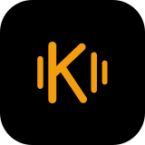

<div align="center">
  
  <h1>Koda</h1>
  <p><strong>Cliente moderno de YouTube Music para Android — 100% libre de anuncios, con tema AMOLED y acentos en amarillo ámbar (<code>#F59E0B</code>).</strong></p>

  <p>
    
    
    
  </p>
</div>

---

## Características principales

- **100% libre de anuncios**: reproduce canciones, álbumes, playlists y podcasts sin cortes publicitarios.
- **Reproducción en segundo plano**: audio continuo con pantalla apagada y controles completos en barra de notificaciones.
- **Letras sincronizadas**: seguimiento en tiempo real con soporte de traducción.
- **Estética AMOLED + Ámbar (`#F59E0B`)**: interfaz en negro puro (`#000000`) pensada para pantallas OLED y ahorro de batería.
- **Modo offline y caché**: descarga pistas y listas para escuchar sin conexión.
- **Audio de alta calidad**: motor Media3/ExoPlayer, normalización de volumen, salto de silencios y ecualizador.
- **Integraciones**: soporte de scrobbling (Last.fm / ListenBrainz), Discord Rich Presence y Chromecast / DLNA.

---

## Stack Tecnológico

- **Lenguaje**: Kotlin (Kotlin Multiplatform)
- **UI**: Jetpack Compose & Material 3 Expressive (`material-kolor`)
- **Audio & Media**: AndroidX Media3 / ExoPlayer
- **Identidad Android**: `com.sebastian.koda`
- **Landing / Descargas**: HTML + CSS puro en [`docs/index.html`](docs/index.html) listo para GitHub Pages

---

## Compilación local (Android)

```bash
# APK Debug (para pruebas rápidas en dispositivo)
./gradlew :androidApp:assembleDebug

# APK Release (requiere variables KEYSTORE_PATH, KEYSTORE_PASSWORD, KEY_ALIAS, KEY_PASSWORD)
./gradlew :androidApp:assembleRelease
```

---

## Aviso y Licencia

> [!NOTE]
> **Koda** es un proyecto adaptado a partir de [Metrolist](https://github.com/MetrolistGroup/Metrolist) bajo licencia **GPL-3.0** ([LICENSE](LICENSE)), desarrollado y personalizado por Sebastián como proyecto de portafolio.
